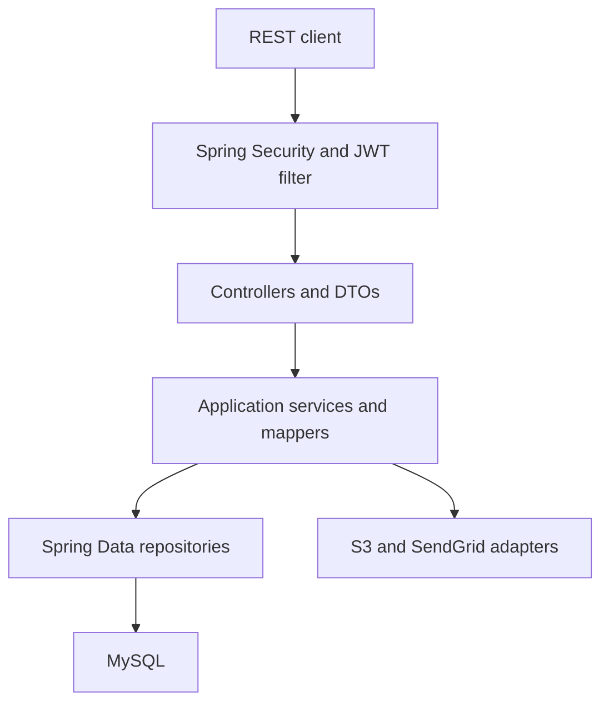

# Architecture and interview case study

## Scope and attribution

This is an educational, collaborative Alkemy application for the fictitious NGO “Somos Más”. Its implementation is a layered monolith, not a distributed system. Luciano Lattante is one of the contributors. The README preserves the complete original team list.

Baseline reviewed: `aa4025e2648f9bfc753937cec7193164b1aba2ab`. This document distinguishes source evidence from verified runtime behavior.

## Implemented structure



| Responsibility | Source |
| --- | --- |
| Authentication and role rules | [SecurityConfiguration](../src/main/java/com/alkemy/ong/security/config/SecurityConfiguration.java) |
| JWT creation/verification | [JwtUtils](../src/main/java/com/alkemy/ong/security/service/JwtUtils.java) |
| Registration and login | [UserAuthController](../src/main/java/com/alkemy/ong/security/controller/UserAuthController.java) |
| Role updates | [UserController](../src/main/java/com/alkemy/ong/controller/UserController.java) |
| Comment ownership and persistence | [CommentServiceImpl](../src/main/java/com/alkemy/ong/service/impl/CommentServiceImpl.java) |
| Unit-test examples | [NewsServiceTest](../src/test/java/com/alkemy/ong/service/NewsServiceTest.java) |
| HTTP-test examples | [UserAuthControllerTest](../src/test/java/com/alkemy/ong/controller/UserAuthControllerTest.java) |

The domain includes users and roles, news and categories, comments linked to users/news, and NGO content such as activities, members, testimonials, slides and organization information.

### Authentication versus authorization

The application issues JWTs for login/registration and uses a request filter to populate the authenticated principal. The code currently sets token lifetime to **10 hours**, not the 30 minutes previously described in the README.

Role updates are handled by **PUT /users/updateRoleUser/{id}**. The earlier POST /auth/updateRolUser route in the README did not match the controller.

Authentication alone does not establish ownership. The maintenance now tests user deletion and owner/admin/third-party comment operations; remaining endpoint policies still need review before public exposure.

### Persistence and consistency

The code uses JPA repositories, service transactions in selected classes and soft-delete fields in several entities. These mechanisms do not establish cross-service delivery guarantees.

There is no implemented Kafka messaging, transactional outbox, distributed transaction protocol or migration framework in this baseline. Email and S3 operations are external side effects; they cannot be rolled back by a local MySQL transaction. Provider failure behavior needs isolated tests.

## Executed verification

With Java 11.0.17 and Maven 3.9.0, the selected local offline run passed 36 tests, zero failures/errors/skips:

```shell
mvn -B -Dtest=JwtUtilsSecurityTest,UserDeletionSecurityTest,NewsServiceTest,CommentAuthorizationTest,CommentAuthorizationWebTest test
```

The scope includes JWT validation, user-deletion permissions, owner/admin/third-party comment behavior, immutable comment author/news references, and existing news-service tests. MockMvc uses the actual security chain and services while persistence is mocked. The full legacy suite, MySQL integration, full startup and live providers were not verified.

Maintenance replaced the embedded signing key with mandatory validated environment configuration, externalized credentials, corrected account/comment authorization, standardized the JUnit engine and migrated the Log4j 1 adapter to SLF4J. See [security verification and limits](SECURITY_REMEDIATION.md).

## Remaining follow-up plan

- Audit/upgrade the rest of the legacy dependency stack and reconcile overlapping API-documentation libraries.
- Run the full suite and disposable MySQL integration tests; isolate provider adapters.
- Review other authorization/ownership policies and seeded accounts before a public demo.
- Confirm owner credential revocation and deployed secret/session configuration.
- Add reproducible local infrastructure, migrations and CI where missing.

## Explaining the project in an interview

“I worked on an educational team API during Alkemy's Java acceleration program. The repository demonstrates layered Spring development, DTOs, validation, authentication and test structure. My recorded contributions include Swagger schemas. In a later review I documented the gap between intended behavior and source configuration, including JWT lifetime, the role-update endpoint and the limits of the existing test setup.”

Discuss a specific commit and distinguish team work from personal contribution. Do not describe this application as production traffic, a microservice platform or proof of a particular throughput.

### Questions grounded in this implementation

- Why is an authenticated request insufficient for DELETE /users/{id}?
- How would you test owner, administrator and unrelated-user permissions with the actual Spring Security filter chain?
- What happens if database persistence succeeds but sending the welcome email fails?
- Why is counting source test annotations different from checking a Surefire report?
- What tradeoff favors a layered monolith for this project's scope?
- Why should API documentation be checked against controller mappings and token configuration?
- How would repository-level filtering improve the comment query without changing its API contract?
