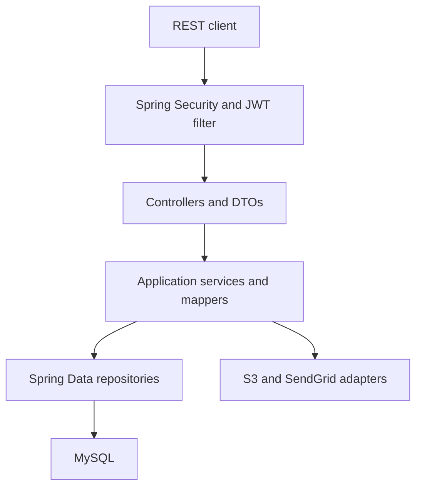

# Architecture and interview case study

## Scope and attribution

This is an educational, collaborative Alkemy application for the fictitious NGO “Somos Más”. Its implementation is a layered monolith, not a distributed system. Luciano Lattante is one of the contributors. The README preserves the complete original team list.

Baseline reviewed: `aa4025e2648f9bfc753937cec7193164b1aba2ab`. This document distinguishes source evidence from verified runtime behavior.

## Implemented structure



| Responsibility | Source |
| --- | --- |
| Authentication and role rules | [SecurityConfiguration](../src/main/java/com/alkemy/ong/security/config/SecurityConfiguration.java) |
| JWT creation/verification | [JwtUtils](../src/main/java/com/alkemy/ong/security/service/JwtUtils.java) |
| Registration and login | [UserAuthController](../src/main/java/com/alkemy/ong/security/controller/UserAuthController.java) |
| Role updates | [UserController](../src/main/java/com/alkemy/ong/controller/UserController.java) |
| Comment ownership and persistence | [CommentServiceImpl](../src/main/java/com/alkemy/ong/service/impl/CommentServiceImpl.java) |
| Unit-test examples | [NewsServiceTest](../src/test/java/com/alkemy/ong/service/NewsServiceTest.java) |
| HTTP-test examples | [UserAuthControllerTest](../src/test/java/com/alkemy/ong/controller/UserAuthControllerTest.java) |

The domain includes users and roles, news and categories, comments linked to users/news, and NGO content such as activities, members, testimonials, slides and organization information.

### Authentication versus authorization

The application issues JWTs for login/registration and uses a request filter to populate the authenticated principal. The code currently sets token lifetime to **10 hours**, not the 30 minutes previously described in the README.

Role updates are handled by **PUT /users/updateRoleUser/{id}**. The earlier POST /auth/updateRolUser route in the README did not match the controller.

Authentication alone does not establish ownership. Endpoint and service authorization require additional tests before this service can be considered safe to expose.

### Persistence and consistency

The code uses JPA repositories, service transactions in selected classes and soft-delete fields in several entities. These mechanisms do not establish cross-service delivery guarantees.

There is no implemented Kafka messaging, transactional outbox, distributed transaction protocol or migration framework in this baseline. Email and S3 operations are external side effects; they cannot be rolled back by a local MySQL transaction. Provider failure behavior needs isolated tests.

## Reproducing verification

Use JDK 11, Maven and a disposable local MySQL database. Review the application configuration and replace credential values before any run. Never connect tests to real customer data or live email recipients.

With dependencies available, the intended commands are:

```bash
mvn -B -Dtest=NewsServiceTest,UserServiceTest test
mvn -B verify
```

The first command selects unit-test classes; it does not run the full suite. The second may load Spring contexts and require database/provider isolation. Do not interpret the existing test source files as proof of passing checks.

The review attempted the first command in offline mode. Application and test compilation completed, then Surefire could not resolve `surefire-testng:2.22.2` from the local cache. **No passing unit or integration test result is claimed.** No live S3 or SendGrid calls were made.

Maven also warned about duplicate JUnit/Mockito dependencies and TestNG with version `RELEASE`. A follow-up should standardize the test engine and pin dependencies before introducing CI.

## Known limitations and follow-up plan

1. Replace the hardcoded signing key with validated environment configuration and test missing/invalid configuration.
2. Add negative authorization tests for deleting another user and for owner/admin/third-party comment operations.
3. Correct the administrator authority check in CommentServiceImpl, which compares the authority count to a role name.
4. Make provider adapters injectable fakes for local tests; disable seeded demo accounts outside a dedicated local profile.
5. Replace obsolete Log4j 1.x and reconcile overlapping Swagger/test dependencies. Apache records Log4j 1.x as end-of-life: https://logging.apache.org/log4j/1.x/ .
6. Introduce explicit database migrations. The current `hibernate.dll-auto` spelling must not be treated as a working schema migration strategy.
7. Move comment filtering from `findAll()` in memory to a paginated repository query.
8. Add Docker Compose, Testcontainers integration tests and CI once the isolated baseline is reproducible.

These are planned improvements, not completed features.

## Explaining the project in an interview

“I worked on an educational team API during Alkemy's Java acceleration program. The repository demonstrates layered Spring development, DTOs, validation, authentication and test structure. My recorded contributions include Swagger schemas. In a later review I documented the gap between intended behavior and source configuration, including JWT lifetime, the role-update endpoint and the limits of the existing test setup.”

Discuss a specific commit and distinguish team work from personal contribution. Do not describe this application as production traffic, a microservice platform or proof of a particular throughput.

### Questions grounded in this implementation

- Why is an authenticated request insufficient for DELETE /users/{id}?
- How would you test owner, administrator and unrelated-user permissions with the actual Spring Security filter chain?
- What happens if database persistence succeeds but sending the welcome email fails?
- Why is counting source test annotations different from checking a Surefire report?
- What tradeoff favors a layered monolith for this project's scope?
- Why should API documentation be checked against controller mappings and token configuration?
- How would repository-level filtering improve the comment query without changing its API contract?
